<div align="center">

# 企业级 CRM 系统从规划到研发

**一个能点、能翻页、能切主题、每页自带「需求文档」的 CRM 原型。规划、设计、实现到验收，都由我一个人完成。**

[](https://feiw3440-cell.github.io/crm-prototype/)
[](https://vuejs.org/)
[](https://element-plus.org/)
[](https://echarts.apache.org/)
[](#已知限制)
[](#技术栈)
[](#本地运行与构建)
[](#测试)

[**👉 打开在线演示**](https://feiw3440-cell.github.io/crm-prototype/) ·
[手机端入口](https://feiw3440-cell.github.io/crm-prototype/#/mobile)

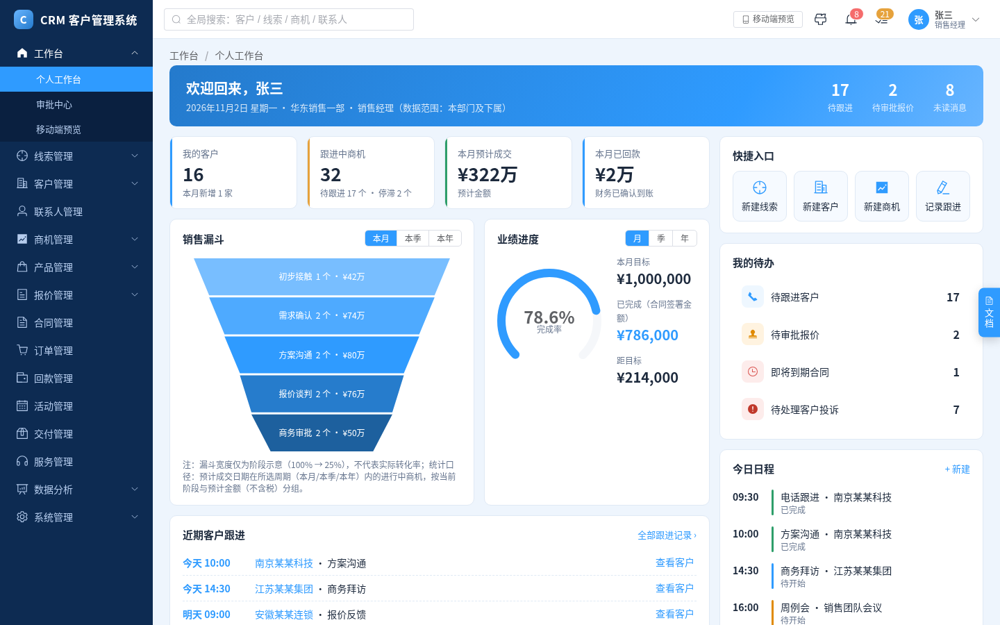

</div>

---

## 目录

- [这是什么](#这是什么)
- [在线演示](#在线演示)
- [功能模块](#功能模块)
- [界面一览](#界面一览)
- [技术栈](#技术栈)
- [架构](#架构)
- [目录结构](#目录结构)
- [本地运行与构建](#本地运行与构建)
- [测试](#测试)
- [我是怎么做的](#我是怎么做的)
- [踩过的坑](#踩过的坑)
- [已知限制](#已知限制)
- [Roadmap](#roadmap)

---

## 这是什么

一句话：**把一份 16 章的 CRM 规划方案，变成一个可以直接点开评审的高保真原型。**

| | |
|---|---|
| **它是什么** | 企业级 CRM 的**纯前端**高保真原型：PC 端 15 个一级模块 + 手机端，数据是前端生成的演示数据，没有后端。 |
| **给谁用** | 产品经理、业务负责人、研发团队：在写后端之前，先**看得见、点得动**地评审需求和流程。 |
| **谁做的** | 我（Fee）：先写规划方案，再设计原型、一批一批做出来，最后对照方案原文逐项验收。 |
| **核心价值** | 每个页面右侧都带一份可编辑的「需求文档」面板，**原型和需求说明放在同一个地方**，评审时对着看，不用在 PRD 和设计稿之间来回翻。 |

规划方案要回答的六个经营问题（方案第一章原文）：

1. 客户从哪里来？线索是否及时处理？
2. 客户由谁负责？客户信息是否完整？
3. 销售进展到哪一步？下一步应该做什么？
4. 哪些商机可能成交？销售业绩能否预测？
5. 合同、订单、回款和交付是否顺畅？
6. 哪些客户需要维护？如何提高续费率与复购率？

> 主线业务闭环（方案第一章、第六章）：**线索 → 客户与联系人 → 商机 → 报价 → 合同 → 订单 → 回款 → 交付与服务 → 复购**。

## 在线演示

- 🖥️ PC 端：<https://feiw3440-cell.github.io/crm-prototype/>
- 📱 手机端预览（PC 页面内的手机框）：<https://feiw3440-cell.github.io/crm-prototype/#/mobile>
- 📱 手机端独立外壳：在地址栏加 `#/m`
- 🎨 顶部栏可切换 **粉 / 天蓝 / 白 / 灰** 四套主题，手机端会跟着变
- 📝 打开任意页面，点右侧边缘的小浮标，就能看到这个页面的需求文档

> 页面里的公司、人名、邮箱都是虚构的演示数据（如「某某科技」、`example.com`）。

## 功能模块

左侧菜单共 **15 个一级模块**（与方案第二章一致），审批中心和手机端是贯穿多个模块的通用能力。

| 模块 | 原型里能点到的页面 |
|---|---|
| 工作台 | 个人工作台、审批中心、移动端预览 |
| 线索管理 | 线索列表、我的线索、线索公海、线索转化记录；线索详情里有「转化客户」弹窗 |
| 客户管理 | 客户列表、我的客户、客户公海、重点客户、客户分类、客户回收站、客户合并；客户详情 12 个 Tab（基本信息 / 联系人 / 跟进记录 / 商机 / 报价 / 合同 / 订单 / 回款 / 服务 / 关系图 / 附件 / 操作日志） |
| 联系人管理 | 联系人列表、联系人详情（含客户内部关系图） |
| 商机管理 | 商机看板、商机列表、商机详情（阶段推进、阶段门、加权预测金额） |
| 产品管理 | 产品目录、价格表 |
| 报价管理 | 报价列表、报价单详情（折扣与审批提示、版本） |
| 合同管理 | 合同列表、合同详情 |
| 订单管理 | 订单列表、订单详情 |
| 回款管理 | 回款计划与收款记录 |
| 活动管理 | 活动列表、活动详情 |
| 交付管理 | 交付列表、交付详情（里程碑） |
| 服务管理 | 服务工单、工单详情 |
| 数据分析 | 经营报表、各报表详情（含销售漏斗） |
| 系统管理 | 用户管理、角色权限、组织架构、操作日志、公海规则、审批模板 |
| 手机端 | 首页、客户、日程与拜访签到、待办、我的、线索、商机与阶段更新、跟进、审批、回款、工单与处理、通知 |

几个让它「像个真系统」的细节：

- **真分页**：列表数据由生成函数产生（约定 ≥ 25 行），分页按页切片，总数取过滤后的真实条数，不写死「共 1,268 条」这类假数字。
- **每个客户用自己的数据**：客户详情里的联系人、跟进、商机、报价、合同、订单、回款、关系图都跟着客户走，不会所有客户共用同一份。
- **流程有校验**：例如线索转化是一个整体操作（客户、联系人、商机一起成功，失败整体回滚的口径）；客户合并是四步向导；已审批通过的报价再修改，会生成新版本并回到草稿。
- **需求文档面板**：见下文「界面一览」。

## 界面一览

### 四套主题

用 CSS 变量实现，选择存在浏览器 `localStorage`（键名 `crm_theme`）。

| 天蓝 | 粉 |
|:---:|:---:|
|  | 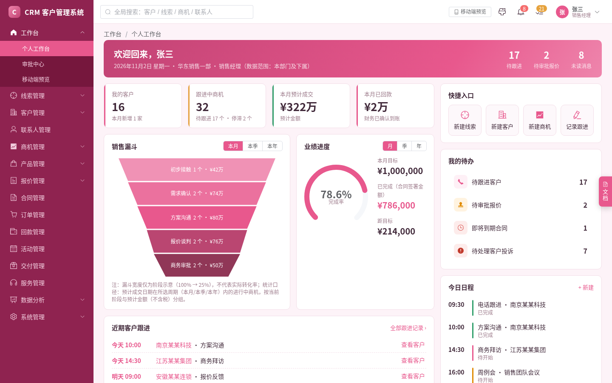 |
| **白** | **灰** |
| 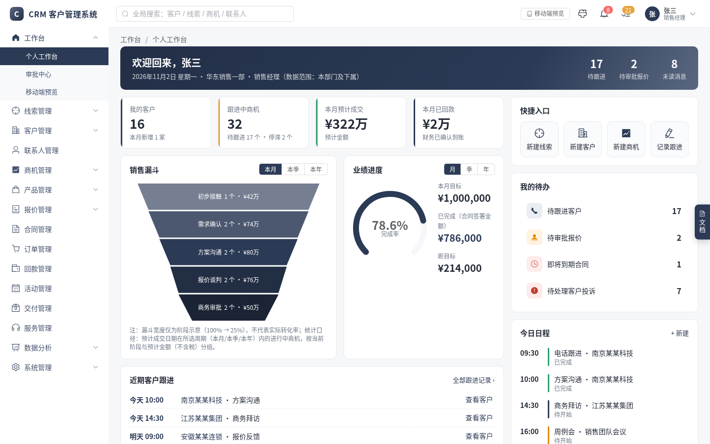 | 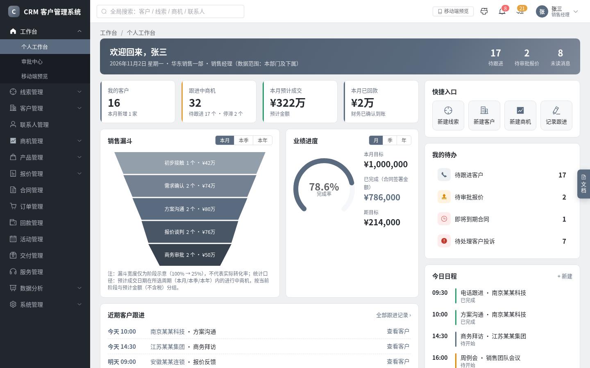 |

### 每页自带需求文档面板

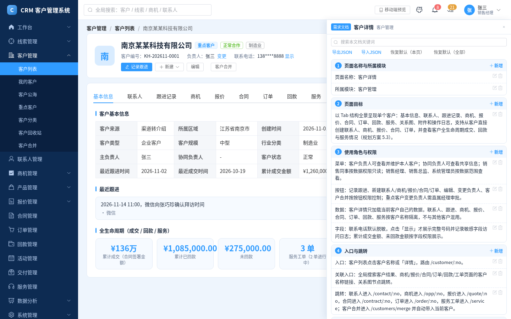

<details>
<summary><b>需求文档面板怎么用（点开展开）</b></summary>

- **三种状态**：隐藏（右侧边缘只剩一个小浮标）→ 半隐藏（窄条，显示页面名称、页面目标和验收标准摘要）→ 完全展开（约 520px 宽，覆盖在页面右侧，不挤压主区域）。状态存在 `localStorage`。
- **固定 12 个要素**：页面名称与所属模块、页面目标、使用角色与权限、入口与跳转、页面布局与元素、字段说明（表格：字段 / 类型 / 必填 / 校验 / 说明）、交互与操作规则、业务规则与状态流转、异常与边界场景、关联数据与接口、验收标准、版本与变更记录。
- **可编辑**：每个要素下的条目可新增、编辑、删除；顶部有关键词搜索（过滤并高亮）；修改保存在 `localStorage`（键名 `crm_docs_v1`）。
- **可交换**：支持导出 JSON、导入 JSON、恢复默认（单页恢复 / 全部恢复）。
- **覆盖面**：PC 路由与手机端每一屏都有对应文档；自动化测试 `docs-check` 在本次实测中检查了 65 份文档，0 份不合格。

</details>

### 几个有代表性的页面

| 线索详情 | 商机详情 |
|:---:|:---:|
| 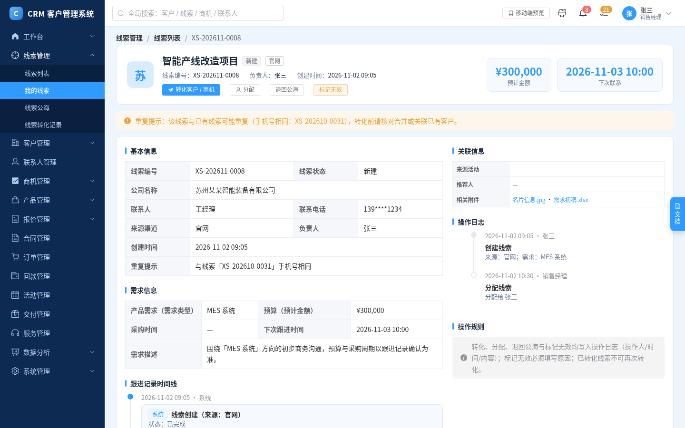 | 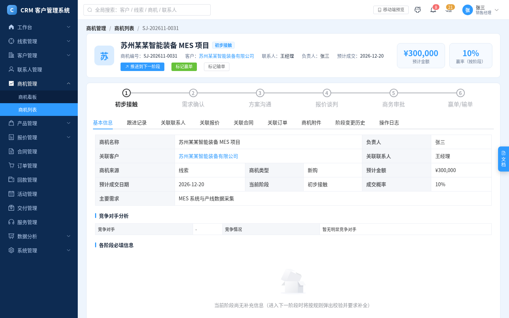 |
| **报价单详情** | **联系人详情 · 客户内部关系图** |
| 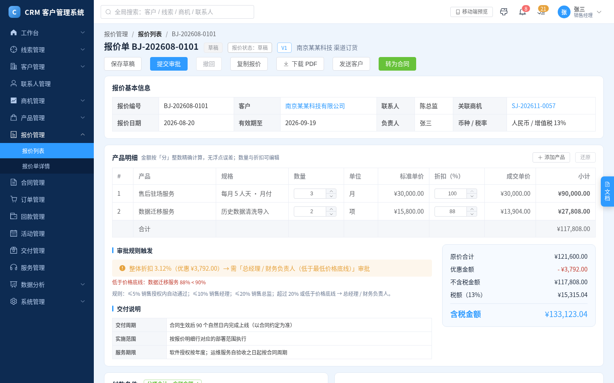 | 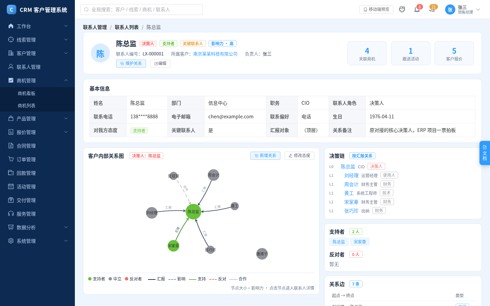 |
| **公海规则配置** | **报表详情 · 销售漏斗** |
| 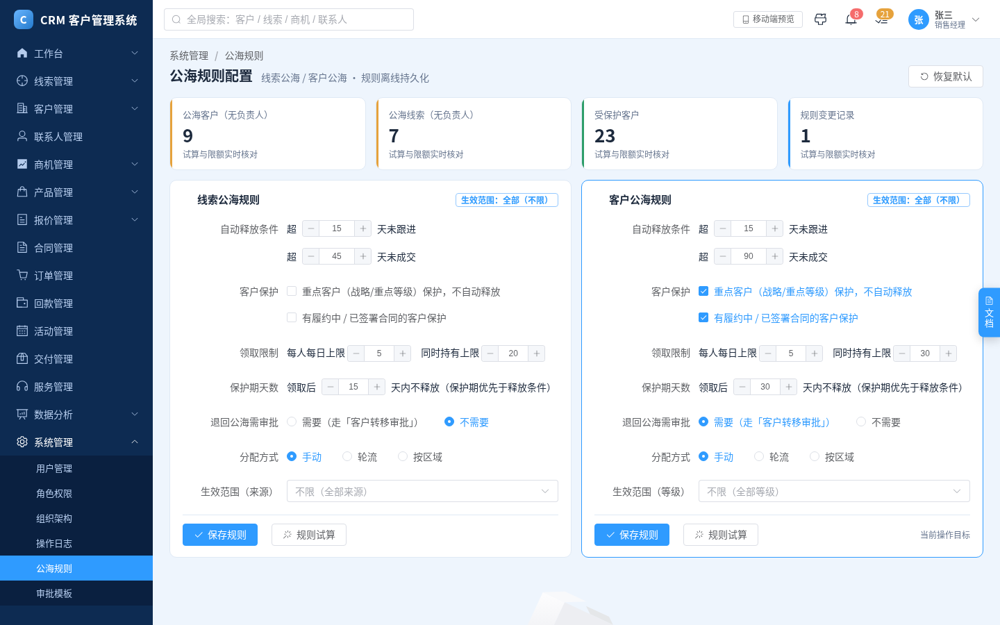 | 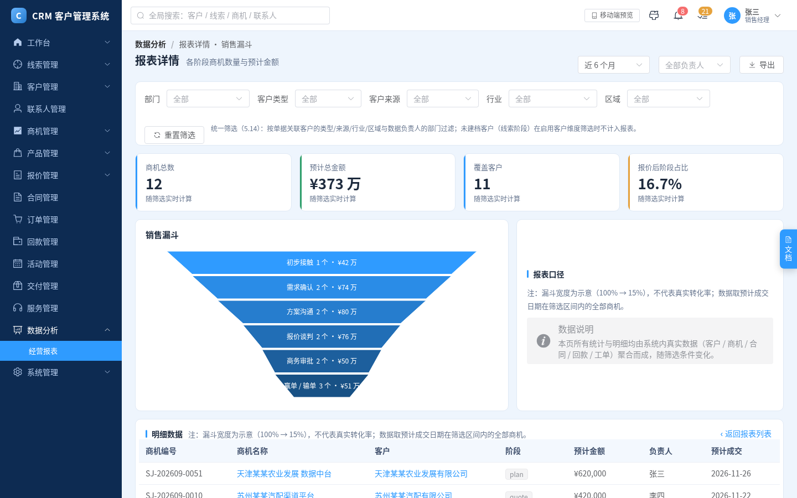 |

### 手机端

手机框内的页面同样跟随主题（下图前四张为天蓝主题，最后一张为粉色主题）：首页、客户列表、商机阶段更新、审批中心。

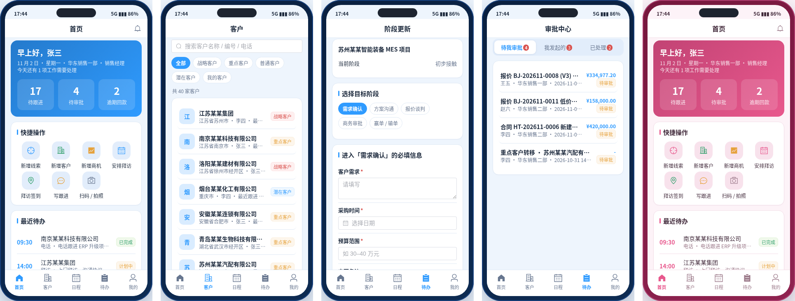

## 技术栈

| 层 | 选型 | 说明 |
|---|---|---|
| 框架 | **Vue 3**（全局构建 `vue.global.prod.js`） | **非 SFC**：不用 `.vue` 文件和 `import/export`，所有代码共享一个全局作用域 |
| UI 组件库 | **Element Plus**（含中文语言包、图标包） | 全站界面文字为中文 |
| 图表 | **ECharts** | 工作台漏斗/业绩进度、数据分析报表 |
| 路由 | 自写的 hash 路由 + `registerRoute()` 注册表 | 每个路由必须带一个 `docKey`，对应需求文档 |
| 状态 | Vue `reactive` 的全局 `store` | 数据在 `data*.js` 里生成，刷新即重置 |
| 构建 | `node build.js`（只用 Node 内置 `fs`） | 把 `src/*.js` + `src/style.css` 拼成**单文件** `index.html` |
| 离线 | 所有第三方库放在 `lib/`，用相对路径引用 | 约定**不引用 CDN**，断网也能打开 |
| 测试 | 无头 Chrome（`playwright-core`）+ 自写断言脚本 | 见 [测试](#测试) |

选择「全局构建 + 单文件产物」的理由很朴素：**零构建工具链依赖**，每次只需要往 `src/` 里加文件，`node build.js` 一条命令就能得到可发布的页面。

## 架构

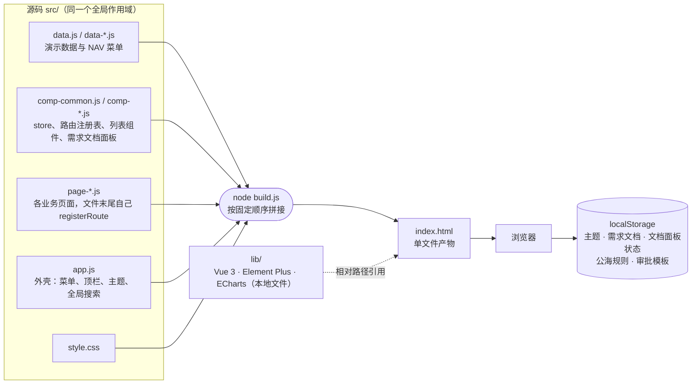

`build.js` 的拼接顺序（也是全局变量的可见顺序）：

```text
data.js → data-*.js（字母序）→ comp-common.js → comp-*.js（字母序）→ page-*.js（字母序）→ app.js
```

新增的 `data-*.js`、`comp-*.js`、`page-*.js` 会被自动收录，**不用改 `build.js`**。

## 目录结构

```text
crm-prototype/
├── PROGRESS.md        # 分阶段进度清单
├── SPEC-ALIGN.md      # 对照规划方案的逐页变更记录与「未实现」清单
├── docs/
│   └── dev-guidelines.md   # 开发约定（技术栈、文件顺序、路由、文档面板、验证要求）
├── build.js           # 把 src/*.js 拼成单文件 index.html
├── index.html         # 构建产物（不要手改）
├── lib/               # vue / element-plus / echarts / 图标 / 中文语言包（离线）
├── spec/
│   └── crm-plan.txt   # 规划方案原文（16 章），冲突时以它为准
├── src/               # 40 个 .js + style.css
│   ├── data.js, data-ext.js, data-docs.js        # 演示数据、菜单、需求文档默认内容
│   ├── comp-common.js, comp-store-ext.js         # store、路由注册表、通用列表组件等
│   ├── comp-docs.js, comp-mobile.js, comp-relgraph.js  # 需求文档面板、手机外壳、关系图
│   ├── page-*.js                                 # 各业务页面（线索、客户、商机、合同……）
│   ├── page-mscr-a.js / page-mscr-b.js           # 手机端各屏
│   ├── page-zz-docs-*.js                         # 各页面需求文档（后加载者覆盖旧版）
│   └── app.js                                    # 应用外壳与路由分发
├── tests/             # all.sh + 8 个测试脚本 + routes.json（全量路由清单）+ shots-final.js（生成验收截图）
└── shots/             # 验收截图
```

## 本地运行与构建

**只想看效果**：克隆仓库后，直接用浏览器打开 `index.html` 即可（所有依赖都在 `lib/`，不需要联网，也不需要 `npm install`）。

**改了源码要重新构建**（只需要 Node.js）：

```bash
node build.js
```

输出会列出本次的拼接顺序，并生成/覆盖根目录的 `index.html`。

> ⚠️ **不要手改 `index.html`**，它是 `src/` 的构建产物，下次构建会被覆盖。
>
> 开发约定（节选自 [`docs/dev-guidelines.md`](./docs/dev-guidelines.md)）：代码是同一个全局作用域，顶层 `const` 名字不能重复，新文件的全局名要带前缀；样式不写死颜色，一律用 CSS 变量，主题切换才会生效；新页面在文件末尾自己 `registerRoute(...)`，并提供对应的需求文档。

## 测试

测试用无头 Chrome 打开页面，检查控制台没有报错、页面有内容、需求文档面板存在，以及一批业务流程断言。一条命令跑全部：

```bash
tests/all.sh
```

它会先 `node build.js`，再依次运行 8 个脚本，全部通过时输出 `ALL TESTS PASSED`：

| 脚本 | 检查什么 |
|---|---|
| `smoke.js` | 逐个打开 `tests/routes.json` 里的全部路由（87 条）：无控制台 error/warning、主区域有内容、文档面板存在 |
| `data-check.js` | 数据层自检：用 Node 的 `vm` 加载 `data.js` + `data-ext.js`，不需要浏览器 |
| `customers-all.js` | 遍历全部客户：详情页无报错、头部客户名与编号正确、各 Tab 可切换，且不同客户的联系人内容不全相同 |
| `mobile.js` | 手机端：底部五个 Tab、客户详情、签到、新建线索 / 商机阶段 / 跟进 / 审批 / 工单 / 通知流程、文档随屏切换、主题切换后手机框主色跟随 |
| `theme-doc.js` | 四套主题互不相同且刷新后恢复；文档面板三种状态切换、新增条目刷新仍在、恢复默认生效 |
| `doc-crud.js` | 需求文档面板：新增 / 编辑 / 删除条目、关键词搜索、导出 / 导入 JSON、恢复默认（PC 页与手机端页都测） |
| `flows.js` | 关键业务交互：工单受理 / 指派、合同提交审批、订单确认、线索标记无效、商机推进等状态流转写回数据，以及真分页和全局搜索 |
| `docs-check.js` | 每个 PC 路由和每个手机屏都有完整的需求文档（12 个要素，每个要素有内容，不是占位骨架） |

> **一次真实的运行记录**（撰写本文时在原型仓库上实测，全部通过）：`smoke` 87 条路由全部通过；`data-check` 299 项断言通过；`customers-all` 40/40 个客户详情通过；`docs-check` 共 65 份文档、0 份不合格。

<details>
<summary><b>运行环境说明（点开展开）</b></summary>

- 需要 Node.js、`playwright-core`（让 Node 能 `require` 到它，例如用 `NODE_PATH` 指向它所在的 `node_modules`），以及本机的 Chrome。
- Chrome 路径默认 `/usr/bin/google-chrome`，可用环境变量 `CHROME_PATH` 覆盖。
- 脚本通过相对路径打开仓库根目录的 `index.html`，在哪里克隆都能跑。
- 新增页面后，记得把路由追加到 `tests/routes.json`，冒烟测试才会覆盖它。

</details>

## 我是怎么做的

做这个原型，我始终守着一条原则：**以规划方案原文为准；大需求切成小批次；每一批都要写完、测过、对照原文看过，再做下一批。** 编码环节借助 AI 编码工具提效，但规划、取舍和验收都是我自己把关。

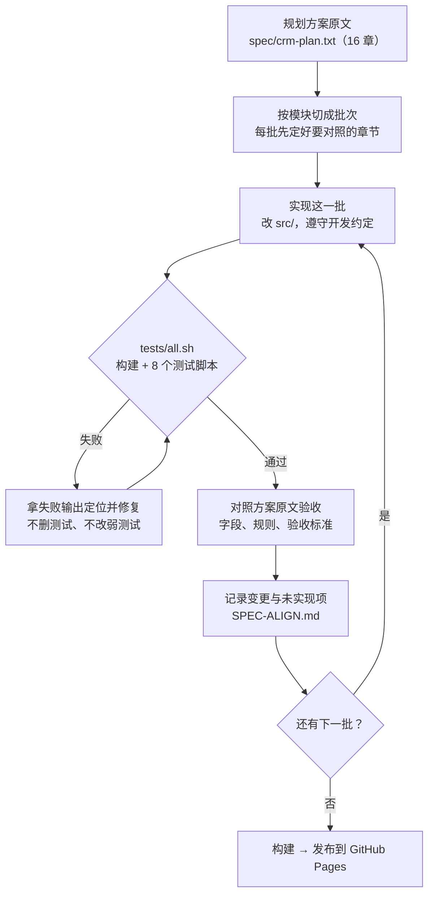

### 1. 先写规划，再动手

先写出一份 16 章的规划方案（定位、模块、角色权限、界面布局、页面详细设计、业务流程、审批与自动化、系统管理、数据设计、技术架构、移动端、异常与边界、实施计划、验收标准、行业扩展、第一版建议），原型里所有字段、状态流转和验收标准都以它为准，两边冲突时改原型，不改方案。

### 2. 分批交付

- 进度按批次勾选，见 [`PROGRESS.md`](./PROGRESS.md)。
- **功能开发轮**：先搭路由注册表、四套主题和需求文档面板，再做数据层，然后按模块做真分页和各详情页（线索、客户、商机、合同、订单、活动、交付、工单）、数据分析与系统管理、手机端，最后补各页面的需求文档。
- **规划对齐轮**：拿方案原文逐模块「校对并纠正」——先校对需求文档里的字段说明、业务规则、验收标准，再修页面里与方案明显矛盾的地方。方案里有但原型做不了的，**老老实实记进「未实现」清单**，不假装做完。
- 每批开工前先明确这一批要对照方案的哪几章（比如线索这一批：5.2 线索管理、6.1 流程一、7.3 自动化提醒，外加第十二章异常场景和第十四章验收标准）。

### 3. 测试闸门

每一批结束都跑 `tests/all.sh`，**没出现 `ALL TESTS PASSED` 就不往下做**。测试失败时，先看失败输出、定位、修复，再重跑；原则是**不删测试、不把测试改弱**。

### 4. 对照原文验收，并留下记录

通过测试之后，我还会对照方案原文再看一遍。每个对齐任务做完，都在 [`SPEC-ALIGN.md`](./SPEC-ALIGN.md) 里按页面追加一节：改了什么、为什么、依据方案哪一章，并列出「规划方案有但本次未实现」的内容。这份记录同时也是下文「已知限制」的来源。

### 开发约定

写在 [`docs/dev-guidelines.md`](./docs/dev-guidelines.md) 里，要点：

| 约定 | 内容 |
|---|---|
| 技术栈 | Vue 3 全局构建（非 SFC）+ Element Plus + ECharts，库放 `lib/`，必须离线可用 |
| 构建 | `src/*.js` 按固定顺序拼成单文件 `index.html`，不手改产物 |
| 路由 | 页面文件末尾自己 `registerRoute(...)`，每个路由必须带 `docKey` |
| 需求文档 | 每个页面和手机端每一屏都有一份，固定 12 个要素 |
| 样式 | 不写死颜色，一律用 CSS 变量，主题切换才会生效 |
| 数据 | 列表必须真分页；每个客户的详情用自己的数据 |
| 验证 | 改完必须 `node build.js` 并跑测试；新页面的路由追加进 `tests/routes.json` |

## 踩过的坑

这些问题都是验收时发现的，也是我觉得最值得记下来的部分。

<details>
<summary><b>1. 把「漏斗示意宽度」当成了「赢率」</b></summary>

方案 5.5 在商机漏斗每个阶段旁标了 `100% / 80% / 60% / 40% / 25% / 15%`，并明确注明：**「此处比例用于展示阶段顺序，不代表实际销售转化率」**。第一版我把这组数字当成了商机的成交概率。

修正后：

- 这组数字改名 `funnelWidth`，**只用来控制漏斗图的显示宽度**。
- 赢率另设一组按阶段的默认值：初步接触 10%、需求确认 25%、方案沟通 45%、报价谈判 65%、商务审批 85%、赢单 100%、输单 0%。**这组默认赢率是原型假设，待业务确认**，不是方案里的规定数字。
- 新增「加权预测金额」= 预计金额 × 赢率，只统计未结束的商机；页面上原来的「成交概率」统一改叫「赢率」。

> 教训：示意图上的数字不一定是业务参数，开发前要先问清楚这个数字是干什么用的。

</details>

<details>
<summary><b>2. 第一版没有逐项对照规划原文</b></summary>

第一版的字段是按「常规 CRM 习惯」写的，没有逐项对照规划原文，所以后来专门做了一整轮对齐：每页的字段、规则和验收标准按方案第五章重写，审批按第七章，手机端按第十一章。

> 教训：做原型时，规划原文要始终摆在手边，不能凭印象或摘要。

</details>

<details>
<summary><b>3. 价格表算出 NaN；已审批报价被改后怎么办</b></summary>

- 价格表明细缺失时，「相对标准价」用缺失的价格去算，页面上出现 `NaN`。改为按回退后的展示价格计算。
- 已审批通过的报价再改金额或折扣，现在会**生成新版本并把审批状态置回草稿**重新审批，操作日志记录版本变化（依据方案 5.7「报价通过后锁定已审批版本，修改价格需生成新版本或重新审批」）。

</details>

## 已知限制

这是**原型**，下面这些只在需求文档里写了口径，**页面上没有真正实现**（详见 [`SPEC-ALIGN.md`](./SPEC-ALIGN.md) 各章节末尾「规划方案有但本次未实现」）：

- **没有后端**：数据都是前端生成的演示数据，刷新后恢复初始；没有持久化存储，也没有事务。
- **登录与权限**：没有登录态；菜单、按钮、数据、字段权限和敏感字段脱敏，只用角色文案和按钮可用性做演示。
- **导入导出**：Excel 的导入导出、按名称/手机号全库查重、错误行反馈，都只是提示文案。
- **自动提醒与调度**：定时提醒、公海自动回收、商机停滞扫描、逾期提醒等没有后台任务和通知中心；由规则试算和提示文案演示。
- **审批引擎**：审批人和节点按组织、金额、折扣、客户等级动态配置没有做；审批模板支持节点类型和启停，但审批单仍是演示数据。
- **文件**：附件上传、下载、PDF 生成、电子签章、「发送客户」都是示例提示。
- **手机端能力**：拍照、语音转文字、真实定位、消息推送是模拟或授权提示，不调用系统能力。
- **配置类**：商机阶段、赢率、字典等是前端静态配置，没有后台配置页面。
- **默认赢率**：10 / 25 / 45 / 65 / 85 是**原型假设，待业务确认**。
- **一些具体缺口**：一个联系人关联多个客户并记录任职关系、竞争对手主数据、区域价格表、产品组合、商机阶段回退审批、交付页的「任务 / 成员 / 文档」独立页签等。

## Roadmap

规划方案本身是**分阶段**上线的（方案第十三章、第十六章）。方案第十六章还把优先级分成 P0（第一版必须实现）到 P3（智能化建设，后续增强）四档。下表是第十三章的四个阶段，以及这个原型目前的覆盖情况：

| 方案阶段 | 方案内容 | 原型现状 |
|---|---|---|
| **第一阶段：CRM 基础版** | 登录与权限、工作台、线索、客户与公海、联系人、跟进管理、基础报表 | 页面与流程已有；**登录与权限仅演示** |
| **第二阶段：销售过程管理** | 商机、产品、报价、合同、审批中心、销售报表 | 页面与流程已有；**审批引擎未实现** |
| **第三阶段：交易与履约管理** | 订单、回款、交付、服务、经营报表 | 页面与流程已有；**自动提醒、对账等未实现** |
| **第四阶段：智能化与集成** | 企业微信、ERP / 财务、电子签章、AI 客户助手、AI 销售助手、智能报表、自动化工作流 | **未开始** |

接下来想做的事（按重要程度）：

- [ ] 补上**后端**：登录、角色与数据权限（必须在服务端校验）、持久化、事务、审计日志
- [ ] **导入导出**：真实 Excel 解析、查重和错误行反馈
- [ ] **自动化提醒与调度**：公海自动回收、跟进 / 停滞 / 逾期 / 到期提醒，以及通知中心
- [ ] **真实审批引擎**：按组织、金额、折扣、客户等级动态路由
- [ ] **配置化**：商机阶段与赢率、字典、SLA 时限的后台配置（赢率默认值需要先和业务确认）
- [ ] 文件服务：附件、PDF、电子签章
- [ ] 补齐方案里有但原型未覆盖的对象：多客户联系人、竞争对手主数据、区域价格表、产品组合
- [ ] 第四阶段：企业微信、ERP / 财务集成、电子签章，以及 AI 客户助手、AI 销售助手

欢迎提 Issue 讨论需求口径，尤其是上面标注「待业务确认」的部分。

---

<div align="center">

规划方案原文见 [`spec/crm-plan.txt`](./spec/crm-plan.txt) · 逐页对齐记录见 [`SPEC-ALIGN.md`](./SPEC-ALIGN.md)

</div>
